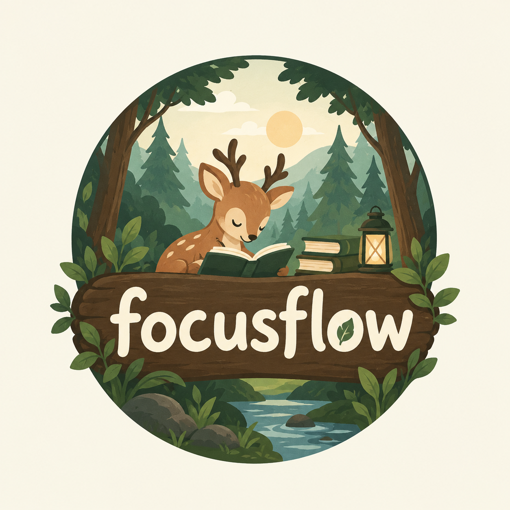

FocusFlow 🌲
A calm, forest-themed study productivity website that helps students plan their work, stay focused, and track their progress in one place.

Built with HTML, CSS, and vanilla JavaScript, FocusFlow features a pixel-inspired forest background, parchment-style cards, moss-green accents, and light and dark themes.

Overview
FocusFlow brings together a daily and weekly planner, calendar, focus timer, study roadmap generator, and productivity dashboard.

The interface is designed to feel encouraging rather than competitive, with simple navigation and manageable study plans.

Features
Dashboard
Personalized greeting using the student’s display name.

Quick-start focus session.

Today’s pending tasks and an overdue-task reminder.

Summary cards for pending tasks, completed tasks, focus time today, and study streak.

Weekly focus-time overview.

Quick links to planning and progress pages.

My Tasks
Daily Tasks and Weekly Planner views.

Add, edit, complete, and delete tasks.

Assign a subject, due date, priority, and estimated duration.

Navigate between weeks.

View completed and pending tasks together.

Receive a gentle warning when planned work exceeds the daily study goal.

Calendar
Monthly calendar with previous and next month navigation.

Highlighted current date and selectable dates.

Add, edit, and delete events.

Store exams, assignment deadlines, personal events, and reminders.

Display task deadlines directly from the shared task data.

Focus Timer
Preset sessions of 15, 25, or 50 minutes.

Custom focus duration.

Start, pause, resume, and reset controls.

Configurable focus, short-break, and long-break durations.

Optional task selection.

Countdown and visual progress indicator.

Completed focus-session history.

Timestamp-based countdown handling for pauses and delayed browser updates.

Only completed focus sessions contribute to recorded focus time. Resetting or replacing an unfinished session does not record its partial duration.

Study Companion
Enter a prompt describing subjects, study duration, and daily availability.

Generate a daily roadmap using local planning rules.

Include study, practice, and revision activities.

Account for estimated time already assigned to pending tasks.

Preview suggested tasks before saving.

Edit or remove individual suggestions.

Regenerate the roadmap.

Confirm before adding tasks to the planner.

Show saved task deadlines in Calendar.

Example prompt:

text
Subjects: algebra, biology, chemistry.
Plan 7 days with 2 hours per day.
Include revision.
The current Study Companion is a local, rule-based planner, not a live AI chatbot. It does not connect to an AI API or require a backend.

Progress
Total completed tasks.

Total recorded focus time.

Tasks completed today.

Current study streak.

Focus time for each day of the current week.

Task completion percentage for the selected period.

Completed and pending tasks by subject.

This week, this month, and all-time filters.

Friendly empty states for new users.

Settings
Editable display name.

Optional daily study goal.

Default focus and break durations.

Light and dark forest themes.

Clear study data with confirmation.

Reset preferences to defaults without deleting study records.

Design
FocusFlow uses a minimal pixel-forest visual style:

Misty green background.

Layered pixel-tree silhouettes.

Warm parchment cards.

Moss-green controls.

Block-style borders and shadows.

Responsive desktop sidebar and mobile navigation.

Upper-left logo on desktop and mobile.

The background scenery is created with inline SVG and CSS, so it does not require external image downloads.

Technology Stack
Technology	Purpose
HTML5	Application structure
CSS3	Forest theme, layout, and responsive styling
Vanilla JavaScript	Navigation, planning, timer, and analytics
Local Storage	Browser-based persistence
Inline SVG	Navigation icons and decorative trees
No framework, package installation, build process, backend, or API key is required for the current version.

Project Structure
text
Focus-flow/
├── index.html
├── app.js
├── logo.png
└── README.md
index.html — application shell, embedded styles, forest scenery, navigation containers, and logo.

app.js — shared data, page rendering, task management, calendar, timer, local roadmap generator, analytics, and settings.

logo.png — custom website logo.

README.md — project documentation.

Getting Started
Download or clone the project.

Keep index.html and app.js in the same folder.

Add your logo image if required.

Open index.html in a modern browser.

For development, you can also serve the folder using a local static server, such as the Live Server extension in your editor.

Keep using the same browser and site address to access the same saved study data. Opening the project through a different address may use a separate browser storage area.

Adding Your Logo
Place your image beside index.html.

In index.html, search for:

xml
<!-- CHANGE YOUR LOGO HERE -->
The desktop and mobile logo sections contain:

xml

Update src in both sections to match your image filename.

For example:

xml
src="./forest-logo.png"
The logo size can be adjusted using the .brand-logo CSS rule.

Data Storage
The following information is saved locally in the browser:

Tasks and completion status.

Calendar events.

Completed focus sessions.

Timer state.

Profile and appearance preferences.

The application uses these local-storage keys:

text
ff_tasks
ff_events
ff_sessions
ff_settings
ff_timer
Data is not uploaded to a server or synchronized between devices.

Clearing browser storage or using the app’s Clear Study Data action can permanently remove saved study records. The app currently has no export or backup feature.

Chatbot Reset Behavior
The Study Companion conversation and unsaved roadmap are kept in memory only.

Refreshing or reopening the website starts a fresh conversation.

Switching between pages inside FocusFlow keeps the current conversation.

Restart Chat clears the current conversation and unsaved preview.

Tasks already added to the planner remain saved.

Analytics Rules
Task Completion Percentage
Task completion is based on tasks whose due dates fall within the selected period:

text
Completion percentage =
(Completed eligible tasks / Total eligible tasks) × 100
When no tasks are eligible, the interface displays an empty-state message instead of dividing by zero.

Study Days
A study day is a local calendar date with at least one completed focus session.

Completing a task alone does not count as a study day.

Study Streak
The streak counts consecutive study days. If no session has been completed today, an existing streak ending yesterday remains visible until today is completed or missed.

Date Filters
This week uses Monday through Sunday.

This month uses the current calendar month.

All time includes all saved records.

The main Progress summary cards show all-time totals, today’s completed tasks, and the current streak. Task completion, subject breakdowns, and the selected-period focus total respond to the date filter. The weekly chart always shows the current week.

Current Limitations
The Study Companion uses simple rules rather than a language model.

It cannot reliably interpret a detailed syllabus or complex conversational follow-ups.

Roadmap previews cover up to 30 days and 60 tasks.

Calendar events do not automatically reduce available study time in local planning mode.

Existing tasks are not automatically rescheduled.

Study data is browser-specific and is not synchronized across devices.

Google Calendar integration is not included.

There are no accounts, cloud backups, or notification systems.

Background timers do not provide operating-system alarms when the browser is closed.

Multiple open tabs are not designed for simultaneous editing.

Future Improvements
Secure backend integration for AI-generated roadmaps.

Improved syllabus interpretation and conversational planning.

Confirmed rescheduling of missed tasks.

Google Calendar synchronization.

Data export and import.

Improved keyboard navigation and accessibility testing.

Automated testing across browsers and screen sizes.

Project Goal
FocusFlow aims to give students one peaceful space to organize their work, focus on manageable tasks, and recognize consistent effort—without rankings, leaderboards, or unnecessary complexity.
